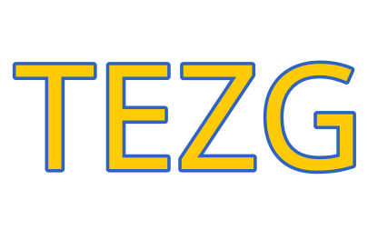

<div align="center">




<sub><b>TCG — but EZ</b> · Collection Tracker + Local Marketplace for Colombia</sub>

<a href="https://raw.githubusercontent.com/PokeAPI/sprites/master/sprites/pokemon/versions/generation-v/black-white/animated/25.gif">
  
</a>

### One accurate, COP-priced view of your Pokémon TCG collection — with a local marketplace growing on top of it.


<br/>


</div>

<br/>

<div align="center">

</div>

<div align="center">
&nbsp;
</div>

Colombian Pokémon TCG collectors, buyers, individual sellers, and small businesses today stitch together eBay, PriceCharting, and Collectr — and eat cross‑border shipping and import‑tax costs to do it. Everything else that exists locally is informal WhatsApp/Telegram groups with no structure.

**TEZG** is being designed as **a collection tracker with a local marketplace attached**: one accurate, COP‑priced view of a collector's cards, their market value, and their wishlist — growing, over time, into a real place to buy, sell, and trade directly with other Colombian collectors.

> Collection‑tracking value ships first and stands on its own. Marketplace liquidity — the seller community — is built on top of it. That's a deliberate sequencing decision, not a gap.

<div align="center">

| | | | |
|:---:|:---:|:---:|:---:|
|  |  |  |  |
| **Collection** | **Marketplace** | **Trading** | **Community** |
| Binder-style tracking of what you own, its condition, and its current market value in COP | Peer‑to‑peer listings for individual sellers and verified businesses — no payment gateway in the middle | Direct card‑for‑card trade offers between individual collectors | Built local‑first for Colombia, growing with the people who actually use it |

</div>

<div align="center">

</div>

## Quick start

You need Docker and nothing else:

```bash
git clone https://github.com/Electromayonaise/Pok-mon-TCG-Marketplace-and-Collection-Management.git tezg
cd tezg
docker compose up -d --wait
curl http://localhost:3000/api/health/ready
# {"ready":true,"checks":{"database":"ok","migrations":"current"},"pending":[]}
```

Compose builds the service, starts PostgreSQL 16, applies the migrations and serves the API on `http://localhost:3000`. Both health probes are green once `--wait` returns. The database runs on tmpfs, so `docker compose down` discards it.

## Development setup

You need Node.js 22 (`.nvmrc`) and Docker.

```bash
npm ci                    # also generates the Prisma client and installs the lint toolchain
cp .env.example .env      # every variable is documented there and validated at start-up
npm run db:up             # PostgreSQL 16 on 127.0.0.1:55432
npm run db:migrate        # creates tezg_dev and applies the migrations
npm run dev               # http://localhost:3000
```

| Command | What it does |
|---|---|
| `npm test` | `npm run db:up`, then `npm run test:ci` |
| `npm run test:ci` | The full suite against a running PostgreSQL: lint, the dependency and Prisma gates, the unit tests, then `gate:impl1` (typecheck, the Solu-2 contract gates, `gate:purity`, the fitness suite and the Impl-1 red gates). CI runs this command |
| `npm run test:unit` | The unit and integration tests colocated with the code (`*.test.ts`) |
| `npm run lint` | ESLint, run from its own toolchain in `tools/lint/` |
| `npm run typecheck` | TypeScript 7, no emit |
| `npm run db:migrate` / `db:reset` | Applies the pending migrations / drops the database and migrates from scratch |
| `npm run db:pull` | Regenerates `prisma/schema.prisma` from the migrations, then the client |
| `npm run gate:deps` | Every dependency pinned exactly, on the approved list, and free of high or critical advisories |
| `npm run gate:prisma` | Fails when `prisma/schema.prisma` drifts from the migrations |
| `npm run gen:api:solu2` | Regenerates `openapi.yaml` from `operations.json` |
| `npm run build` / `start` | Production build and server |

The tests need only `npm run db:up`: each test file gets its own database, cloned from a template migrated once per run. They reach PostgreSQL through `TEZG_PG_HOST`, `TEZG_PG_PORT`, `TEZG_PG_USER`, `TEZG_PG_PASSWORD` and `TEZG_PG_DB` (defaults: `127.0.0.1:55432`, user, password and maintenance database `tezg`).

### Troubleshooting: port 55432 on Windows

Windows (WinNAT/Hyper-V) can reserve a port range that includes 55432. `npm run db:up` (or `docker compose up`) then fails because the port is not available. `netsh interface ipv4 show excludedportrange protocol=tcp` lists the reserved ranges. There are two fixes:

- **Release the range.** In an administrator PowerShell, run `net stop winnat` and then `net start winnat`. Then run `npm test` as usual.
- **Use another port.** Start PostgreSQL 16 on a free port and point the tests at it:

  ```bash
  docker run -d --name tezg-pg-alt -p 15432:5432 -e POSTGRES_USER=tezg -e POSTGRES_PASSWORD=tezg postgres:16.6
  export TEZG_PG_PORT=15432
  npm run test:ci
  ```

  For `npm run dev`, also change the port in `DATABASE_URL` in `.env`.

## What Impl-1 delivers

The delivery of 2026-10-26 (decision log #22) is the foundation and the first three Identity stories. The other Impl-1 stories follow one epic at a time, and their ATDD tests stay red for the right reason (`NotImplementedError`) until then.

| Story | What it guarantees |
|---|---|
| 1.1 | Every refusal is one `{ error: ErrorBody }`: a registry code, its HTTP status, an es-CO message and a cited decision. A stack trace never reaches the client |
| 1.2 | Every change is audited in its own transaction (`audit_events`, append-only), and regulated values are redacted from every log line, audit row and error |
| 1.3 | Every committed event reaches each subscriber exactly once in effect: a transactional outbox, at most 3 attempts, a sweeper and an admin replay |
| 2.1 | An individual seller completes their profile and claims the track in one transaction. The phone is stored only in the profile |
| 2.2 | When a profile completion and a business claim race on one account, exactly one track wins (proven over 100 concurrent repetitions) |
| 2.3 | An account that may not list learns why and when it may reapply. Capabilities, verification and eligibility come from one pure projection |

[`docs/impl-1/walkthrough-impl1.md`](docs/impl-1/walkthrough-impl1.md) covers each story's goal, procedures, database changes and test evidence, together with the gate output. Each story's full record is in `docs/impl-1/implementation-artifacts/`.

## Architecture

TEZG is a modular monolith in hexagonal style (Plan-2 ARCHITECTURE, Solu-2 detailed design):

- **Inbound adapters.** A Next.js 16 App Router app with no pages. `app/api/trpc/[trpc]/route.ts` serves tRPC 11 on the non-batched wire. `app/api/health/` holds the liveness and readiness probes.
- **Modules.** The 12 logical modules live in nine folders under `src/modules/<module>/`: `identity` (IDN, VER), `catalog`, `listings` (INV, DSC), `orders`, `commission`, `trading`, `messaging`, `collections` (COL, VAL) and `reviews`. Each folder has a `domain/` (pure: no framework, driver, network or wall clock; `gate:purity` enforces it), `application/`, `ports/`, `dto/` and `infra/`. Other modules may import it only through its `index.ts`, and only along the AD-1 edges.
- **Persistence.** PostgreSQL 16. The SQL DDL in `docs/solu-2/planning/detailed-design/schemas/` is the schema source of truth: `npm run db:migrate` applies it, and every table belongs to exactly one module. Repositories run SQL through the `Sql`/`Tx` ports. The Prisma model is generated from the migrated database and backs Better Auth only.
- **Shared kernel.** `src/shared-kernel/` holds the ports (`Clock`, `IdGenerator`, `TransactionRunner`, the outbox), the error registry, the event registry and the validated configuration (`config.ts`).
- **Determinism.** Time and ids come only through ports. Every external system is a simulated adapter, and the tests run behind a network guard on a virtual clock.

| Path | Contents |
|---|---|
| `app/` | Route handlers (tRPC, health) |
| `src/` | Modules, shared kernel, server wiring (`src/server/`) |
| `prisma/schema.prisma` | Generated model (`npm run db:pull`) |
| `test-support/` | Test harness: per-file databases, virtual clock, ids, simulated adapters, the Reference Seed Profile (`fixtures/`) |
| `docs/solu-2/` | Detailed design (`contracts.md`, `openapi.yaml`, events, DDL) and the ATDD and fitness suites |
| `docs/impl-1/` | The Impl-1 statement, the walkthrough (`walkthrough-impl1.md`), the story files and sprint status (`implementation-artifacts/`), and the AI decision log (`ai-log/`) |
| `scripts/`, `tools/lint/` | Gates, generators, the migration runner, the lint toolchain |

<div align="center">
&nbsp;
</div>

<div align="center">


</div>

<div align="center">
&nbsp;
</div>

- **Peer‑to‑peer settlement, no payment gateway** — the platform never holds funds; buyers and sellers confirm payment and receipt between themselves.
- **Module boundaries are real boundaries** — each module (catalog, listings, orders, trading, commission, collection, identity...) owns its own data and exposes a public interface; nothing reaches into another module's internals.
- **Local‑first, COP‑native** — money, dates, and pricing are designed around Colombia from the start, not bolted on later.

<div align="center">

</div>

<div align="center">

<sub>TCG, but EZ.</sub>


</div>
