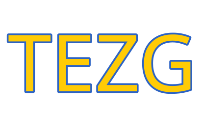

<div align="center">



<sub><b>TCG — but EZ</b> · Collection Tracker + Local Marketplace for Colombia</sub>

</div>

# TEZG

One accurate, COP-priced view of a Pokémon TCG collection, with a local marketplace growing on top of it: track what you own and what it is worth, buy from verified shops, and trade card for card with other Colombian collectors.

## Repository map

| Folder | What it is | Status |
|---|---|---|
| [`backend/`](backend/README.md) | The service: a Next.js 16 app serving tRPC 11 over PostgreSQL 16, with Better Auth sessions, scheduled jobs and health probes. It also holds the planning artifacts, the test suites and the course deliverables (`_bmad-output/`, `docs/`) | Built: 72 of 72 stories done |
| [`frontend/`](frontend/README.md) | The React app that will be the product's user interface | Planned: see [`frontend/docs/FRONTEND_PLAN.md`](frontend/docs/FRONTEND_PLAN.md) |
| `.github/workflows/` | The quality gates. The backend gates run from `backend/` | |
| `.agents/`, `.claude/`, `.cline/`, `_bmad/` | AI tooling (BMAD and WDS skills and their configuration). BMAD writes to `backend/_bmad-output/` | |

The two apps are independent. Neither imports the other, each has its own README and tooling, and either folder can be split into its own repository with `git subtree split --prefix=<folder>`.

## Run it

Everything runnable today is the backend. From a fresh clone:

```bash
git clone -c core.longpaths=true https://github.com/Electromayonaise/Pok-mon-TCG-Marketplace-and-Collection-Management.git tezg
cd tezg/backend
docker compose down && docker compose up -d --wait
curl http://localhost:3000/api/health/ready
```

`core.longpaths=true` is needed on Windows, because some paths under `.agents/skills/` are longer than 260 characters.

For the development setup, the demo accounts, the API examples and the tests, read [`backend/README.md`](backend/README.md).

## Where to read next

- **Using or changing the service**: [`backend/README.md`](backend/README.md)
- **The frontend plan and its design**: [`frontend/docs/FRONTEND_PLAN.md`](frontend/docs/FRONTEND_PLAN.md) and [`frontend/docs/THEMES.md`](frontend/docs/THEMES.md)
- **Course deliverables, one summary per task**: [`backend/docs/README.md`](backend/docs/README.md)
- **Every planning artifact**: [`backend/_bmad-output/README.md`](backend/_bmad-output/README.md)
