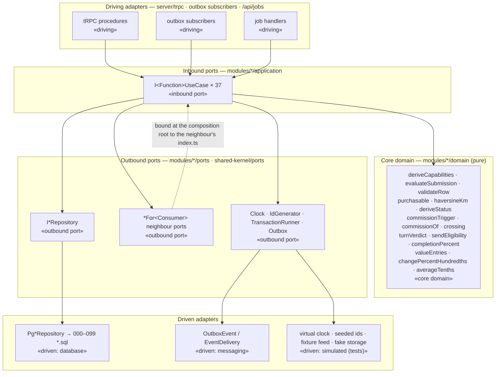

# Ports & Adapters map

Each planning module runs inside its host code module (ARCH §2), and every host has the same hexagonal shape (ARCH §3). The tables below place every component of the 37 contracts in exactly one layer and name the file that holds it.

**Layer rules** (enforced by review and, in Solu-2, by lint):

1. **Core Domain** (`modules/<host>/domain/`) imports nothing but `shared-kernel/types` and `shared-kernel/errors`. It has no SQL, no driver, no `Date.now()`, no `new Date()` without arguments, no `Math.random`, and no network (AD-SYS-6).
2. **Inbound Ports** (`modules/<host>/application/<code>.ts`, the `I<Function>UseCase` interfaces) take DTOs (`modules/<host>/dto/`) plus, where the contract joins a caller's transaction, a `Tx`.
3. **Outbound Ports** (`modules/<host>/ports/`) are interfaces declared by the consuming module (ARCH §3). Neighbour modules are reached only through them, and each one is bound to the neighbour's public `index.ts` at the composition root.
4. **Driven Adapters** (`modules/<host>/infra/pg.ts`) implement the repository ports against the module's own tables only (AD-8). Each one is governed by its migration in `docs/solu-1/planning/schemas/`.
5. **Driving Adapters** are the tRPC procedures (`server/trpc/`), the outbox subscribers and the `/api/jobs/*` handlers. They exist in the architecture (ARCH §3) but are not written in Solu-1, because they would be production wiring. Each one calls exactly one inbound port.
6. **Shared driven adapters** — the `Clock`, `IdGenerator`, `TransactionRunner` and `Outbox` ports live in `shared-kernel/ports.ts`. Their test bindings (virtual clock, deterministic ids, the Postgres harness) are in `test-support/` (Phase 3).

---

## 1. IDN — `identity`

| Component Name | Hexagonal Architecture Layer | Governed By Rule |
|---|---|---|
| `access.completeIndividualProfile`, `verification.submit` (tRPC); `requireCanBuy` middleware | **Driving Adapter** (Inbound tRPC) | Session `userId` → `actorId`; zod input → `ClaimSellerTrackRequestDTO` |
| `IRequireListingEligibilityUseCase`, `IClaimSellerTrackUseCase`, `IGetSellerVerificationUseCase` (`identity/application/idn.ts`) | **Inbound Port** | Define `requireListingEligibility(dto)`, `claimSellerTrack(tx, dto)`, `getSellerVerification(dto)` |
| `deriveCapabilities(facts)` (`identity/domain/idn.ts`) | **Core Domain & Invariants** | AD-IDN-1 *one pure function over one fact read*; AD-16 |
| `IUserRepository` (`identity/ports/idn.ts`) | **Outbound Port** | Defines `claimTrackConditionally(tx, userId, track)` → `0 \| 1`, `loadFacts(ids ≤ 500)` |
| `PgUserRepository` (`identity/infra/pg.ts`) | **Driven Adapter** (Database) | `001_create_identity_user_and_profile.sql` (+ composite FK in 002) |
| `Clock` (`shared-kernel/ports.ts`) | **Driven Adapter** (System clock / virtual clock) | AD-SYS-6 |

## 2. VER — `identity`

| Component Name | Hexagonal Architecture Layer | Governed By Rule |
|---|---|---|
| `verification.submit`, `verification.approve`, `verification.reject` (tRPC, `adminProcedure`) | **Driving Adapter** (Inbound tRPC) | Admin session; zod → `DecideApplicationRequestDTO` |
| `IAssertCanSubmitApplicationUseCase`, `IDecideApplicationUseCase`, `IGetBusinessPaymentInstructionsUseCase` (`identity/application/ver.ts`) | **Inbound Port** | Define `assertCanSubmitApplication(tx, dto)`, `decideApplication(dto)`, `getBusinessPaymentInstructions(dto)` |
| `evaluateSubmission(latest, now)` (`identity/domain/ver.ts`) | **Core Domain & Invariants** | AD-VER-3 *reapplication derived from the snapshot* |
| `IBusinessApplicationRepository`, `IRejectionReasonRepository`, `IBusinessProfileRepository` (`identity/ports/ver.ts`) | **Outbound Port** | `transitionFromPending(tx, id, change)` → `0 \| 1`; `findActiveForShare(tx, code)` |
| `PgBusinessApplicationRepository`, `PgRejectionReasonRepository`, `PgBusinessProfileRepository` | **Driven Adapter** (Database) | `002_create_identity_business_application.sql` |
| `Outbox` → `BusinessApplicationApproved` / `Rejected` | **Driven Adapter** (Messaging, in-process outbox) | AD-SYS-2; ADD-§5 payloads; subscribers `commission`, `listings` |

## 3. CAT — `catalog`

| Component Name | Hexagonal Architecture Layer | Governed By Rule |
|---|---|---|
| `catalog.feed.start`, `catalog.feed.continue` (tRPC, `adminProcedure`); `daily-night` job | **Driving Adapter** (Inbound tRPC / Job) | Admin session or `JOBS_SECRET` |
| `AdminGuard.assertCatalogAdmin(dto)` (`src/server/trpc/admin-guard.ts`) → `identity.requireAdmin` | **Driving Adapter** (procedure-builder guard) | contracts.md §3 guard; AD-1 keeps `catalog` dependency-free (review E-23) |
| `IStartFeedRunUseCase`, `IUpsertCatalogEntryUseCase`, `IGetReferencePriceAsOfUseCase` (`catalog/application/cat.ts`) | **Inbound Port** | Define `startFeedRun(dto)`, `upsertCatalogEntry(tx, dto)`, `getReferencePriceAsOf(dto)` |
| `validateRow(row, ctx)`, `diffAttributes(stored, incoming)` (`catalog/domain/cat.ts`) | **Core Domain & Invariants** | AD-CAT-1 *idempotent batches*; ADD-§8.1 + `KindChanged` (GAP-4) |
| `IFeedRunRepository`, `ICatalogEntryRepository`, `IReferencePriceRepository` (`catalog/ports/cat.ts`) | **Outbound Port** | `insertRunning(tx, row)` → `'inserted' \| 'conflict'`; `upsertByExternalKey(tx, …)` |
| `PgFeedRunRepository`, `PgCatalogEntryRepository`, `PgReferencePriceRepository` | **Driven Adapter** (Database) | `003_create_catalog.sql` |
| `CatalogFeedSource` (fixture adapter with fault switches) | **Driven Adapter** (External feed) | ADD-§8.3; OQ-9 |

## 4. DSC — `listings` (no tables)

| Component Name | Hexagonal Architecture Layer | Governed By Rule |
|---|---|---|
| `discovery.search`, `discovery.cardDetail` (tRPC, `publicProcedure`) | **Driving Adapter** (Inbound tRPC) | zod → `SearchRequestDTO`, `GetCardDetailRequestDTO` |
| `IAssertSearchAreaUseCase`, `ISearchUseCase`, `IGetCardDetailUseCase` (`listings/application/dsc.ts`) | **Inbound Port** | Define `assertSearchArea(dto)`, `search(dto)`, `getCardDetail(dto)` |
| `validateSearchArea`, `haversineKm`, `insideRadius`, `compareRank` (`listings/domain/dsc.ts`) | **Core Domain & Invariants** | AD-DSC-1 *one SQL path = TS reference*; ADD-§2.3, §2.4 |
| `IDiscoveryQuery` (`listings/ports/listings.ts`) | **Outbound Port** | `searchListings(input)` — one statement |
| `CatalogForListings`, `IdentityForListings` (`listings/ports/listings.ts`) | **Outbound Port** (neighbours) | AD-DSC-2: ≤ 3 calls per request |
| `PgDiscoveryQuery` (`listings/infra/pg.ts`) | **Driven Adapter** (Database, read-only) | reads `004_create_listings_inventory.sql` tables |

## 5. INV — `listings`

| Component Name | Hexagonal Architecture Layer | Governed By Rule |
|---|---|---|
| `inventory.update` / `restock` / `deactivate` (tRPC); `orders.create` (caller of reserve); `dev.inventory.race` | **Driving Adapter** (Inbound tRPC / synchronous command) | Session `actorId`; `orders` passes its `tx` |
| `IAssertListingOwnerUseCase`, `IReserveForPurchaseUseCase`, `IGetAvailabilitySummaryUseCase` (`listings/application/inv.ts`) | **Inbound Port** | Define `assertListingOwner(dto)`, `reserveForPurchase(tx, dto)`, `getAvailabilitySummary(dto)` |
| `purchasable(facts)`, `availability(kind, units)` (`listings/domain/inv.ts`) | **Core Domain & Invariants** | AD-INV-3 *fail-closed purchasability*; AD-INV-1 rule 2 |
| `IInventoryUnitRepository`, `IListingRepository` (`listings/ports/listings.ts`) | **Outbound Port** | `decrementConditionally(tx, unitId, required)` |
| `PgInventoryUnitRepository`, `PgListingRepository` | **Driven Adapter** (Database) | `004_create_listings_inventory.sql` |

## 6. ORD — `orders`

| Component Name | Hexagonal Architecture Layer | Governed By Rule |
|---|---|---|
| `orders.confirmPaid`, `orders.get` (tRPC); expiry tick and crons | **Driving Adapter** (Inbound tRPC / Job) | Session `actorId` |
| `IAssertOrderVisibleUseCase`, `IConfirmPaidUseCase`, `IHasClosedPurchaseUseCase` (`orders/application/ord.ts`) | **Inbound Port** | Define `assertOrderVisible(dto)`, `confirmPaid(dto)`, `hasClosedPurchase(dto)` |
| `deriveStatus(facts, now)`, `paidLoserCode(facts, isBuyer, now)` (`orders/domain/ord.ts`) | **Core Domain & Invariants** | AD-ORD-2 *facts set once; expiry derived*; AD-2 |
| `IOrderRepository` (`orders/ports/ord.ts`) | **Outbound Port** | `setPaidConditionally(tx, orderId, buyerId, now)` → `0 \| 1` |
| `ListingsForOrders` (`orders/ports/ord.ts`) | **Outbound Port** (neighbour) | `releaseReservation(tx, ref)` (AD-6) |
| `PgOrderRepository` | **Driven Adapter** (Database) | `005_create_orders.sql` |
| `ObjectStorage` (comprobante) | **Driven Adapter** (Storage, fake in tests) | AD-SYS-8 rule 5 |

## 7. COM — `commission`

| Component Name | Hexagonal Architecture Layer | Governed By Rule |
|---|---|---|
| Outbox subscribers `onOrderPaymentConfirmedByBusiness`, `onOrderClosed`; `commission.topUpProofUrl` (tRPC) | **Driving Adapter** (Inbound event / tRPC) | AD-SYS-2 rule 4; delivery `tx` |
| `IAssertTopUpVisibleUseCase`, `IApplyOrderDeductionUseCase`, `IFindCommissionAccountUseCase` (`commission/application/com.ts`) | **Inbound Port** | Define `assertTopUpVisible(dto)`, `applyOrderDeduction(tx, event)`, `findCommissionAccount(dto)` |
| `commissionTrigger(facts)`, `commissionOf(total, bps)`, `crossing(before, after)` (`commission/domain/com.ts`) | **Core Domain & Invariants** | AD-SYS-3; AD-COM-1 *one atomic update + one entry*; ADD-§2.6 |
| `ICommissionLedgerRepository`, `ICommissionAccountRepository`, `ITopUpRepository` (`commission/ports/com.ts`) | **Outbound Port** | `applyDeduction(tx, entry)` inside `SAVEPOINT apply_deduction` |
| `PgCommissionLedgerRepository`, `PgCommissionAccountRepository`, `PgTopUpRepository` | **Driven Adapter** (Database) | `006_create_commission.sql` |
| `Outbox` → `CommissionBalanceExhausted` / `Replenished` | **Driven Adapter** (Messaging) | AD-SYS-2; subscriber `listings` |

## 8. TRD — `trading`

| Component Name | Hexagonal Architecture Layer | Governed By Rule |
|---|---|---|
| `trading.accept`, `trading.offer` (tRPC); `dev.trading.race` | **Driving Adapter** (Inbound tRPC) | Session `actorId` |
| `IAssertActorTurnUseCase`, `IAcceptOfferUseCase`, `IFindOpenOfferUseCase` (`trading/application/trd.ts`) | **Inbound Port** | Define `assertActorTurn(dto)`, `acceptOffer(dto)`, `findOpenOffer(dto)` |
| `deriveOfferStatus(offer, now)`, `turnVerdict(offer, actorId, now)` (`trading/domain/trd.ts`) | **Core Domain & Invariants** | AD-TRD-1 *conditional update on status, turn, version, expiry* |
| `ITradeOfferRepository` (`trading/ports/trd.ts`) | **Outbound Port** | `lockSeller(tx, sellerId)`, `acceptConditionally(tx, id, version, now)` → `0 \| 1` |
| `ListingsForTrading` (`trading/ports/trd.ts`) | **Outbound Port** (neighbour) | `getTradeability`, `reserveForTrade(tx, …)`, `generateContactMessage` (AD-4) |
| `PgTradeOfferRepository` | **Driven Adapter** (Database) | `007_create_trading.sql` |
| `Outbox` → `TradeAccepted` | **Driven Adapter** (Messaging) | no V1 subscriber (ARCH §7.1) |

## 9. MSG — `messaging`

| Component Name | Hexagonal Architecture Layer | Governed By Rule |
|---|---|---|
| `messaging.send`, `messaging.thread` (tRPC, `requireCanBuy`) | **Driving Adapter** (Inbound tRPC) | Session `actorId` |
| `IAssertConversationParticipantUseCase`, `ISendMessageUseCase`, `IFindConversationUseCase` (`messaging/application/msg.ts`) | **Inbound Port** | Define `assertConversationParticipant(dto)`, `sendMessage(dto)`, `findConversation(dto)` |
| `sendEligibility(role, status)`, `normalizeBody(body)` (`messaging/domain/msg.ts`) | **Core Domain & Invariants** | AD-MSG-2 rule 2 (split by sender role, review F-15) |
| `IConversationRepository` (`messaging/ports/msg.ts`) | **Outbound Port** | `allocateSeq(tx, …)`, `insertMessage(tx, row)` → `'inserted' \| 'duplicate'` |
| `IdentityForMessaging` (`messaging/ports/msg.ts`) | **Outbound Port** (neighbour) | `requireMessagingEligibility(userId)` (review F-02) |
| `PgConversationRepository` | **Driven Adapter** (Database) | `008_create_messaging.sql` |

## 10. COL — `collections`

| Component Name | Hexagonal Architecture Layer | Governed By Rule |
|---|---|---|
| `collections.prompts.accept`, `collections.binder` (tRPC); outbox subscriber `onOrderClosed` | **Driving Adapter** (Inbound tRPC / event) | Session `actorId` |
| `IAssertCollectionOwnerUseCase`, `IAcceptPromptUseCase`, `IGetSetCompletionUseCase` (`collections/application/col.ts`) | **Inbound Port** | Define `assertCollectionOwner(dto)`, `acceptPrompt(dto)`, `getSetCompletion(dto)` |
| `completionPercent(owned, count)`, `bogotaDate(instant)` (`collections/domain/col.ts`) | **Core Domain & Invariants** | AD-COL-1 rule 5; AD-COL-2 rule 2 |
| `ICollectionRepository`, `IPromptRepository` (`collections/ports/collections.ts`) | **Outbound Port** | `lockOwner(tx, ownerId)`, `acceptConditionally(tx, …)` |
| `CatalogForCollections` (`collections/ports/collections.ts`) | **Outbound Port** (neighbour) | `getEntries`, `getSetSummaries` (AD-1 edge) |
| `PgCollectionRepository`, `PgPromptRepository` | **Driven Adapter** (Database) | `009_create_collections.sql` |

## 11. VAL — `collections` (no tables)

| Component Name | Hexagonal Architecture Layer | Governed By Rule |
|---|---|---|
| `valuation.current`, `valuation.trend` (tRPC) | **Driving Adapter** (Inbound tRPC) | Session `actorId` |
| `IAssertValuationPeriodUseCase`, `IValueCollectionUseCase`, `IChangePercentUseCase` (`collections/application/val.ts`) | **Inbound Port** | Define `assertValuationPeriod(dto)`, `valueCollection(dto)`, `changePercent(dto)` |
| `isValuationPeriod`, `valueEntries`, `changePercentHundredths` (`collections/domain/val.ts`) | **Core Domain & Invariants** | AD-VAL-1 *pure BigInt valuation*; AD-VAL-2 rule 3; AD-SYS-7 |
| `ICollectionRepository.entriesForValuation`, `CatalogForCollections.getReferencePricesAsOf` | **Outbound Port** | One `REPEATABLE READ` snapshot (GAP-2) |
| `PgCollectionRepository` (read) | **Driven Adapter** (Database) | `009_create_collections.sql` |

## 12. REP — `reviews`

| Component Name | Hexagonal Architecture Layer | Governed By Rule |
|---|---|---|
| `reputation.write`, `reputation.admin.hide`, `reputation.profile` (tRPC) | **Driving Adapter** (Inbound tRPC) | Session / admin session |
| `IAssertVerifiedPurchaserUseCase`, `IHideReviewUseCase`, `IGetAggregatesUseCase` (`reviews/application/rep.ts`) | **Inbound Port** | Define `assertVerifiedPurchaser(dto)`, `hideReview(dto)`, `getAggregates(dto)` |
| `averageTenths(sum, count)`, `reviewVerdict(input)` (`reviews/domain/rep.ts`) | **Core Domain & Invariants** | AD-REP-1, AD-REP-2 rule 1; ADD-§2.9 |
| `IReviewRepository` (`reviews/ports/rep.ts`) | **Outbound Port** | `hideConditionally(tx, …)`, `sumsAndCounts(ids)` |
| `IdentityForReviews`, `OrdersForReviews` (`reviews/ports/rep.ts`) | **Outbound Port** (neighbours) | `getReviewTarget`, `hasClosedPurchase` |
| `PgReviewRepository` | **Driven Adapter** (Database) | `010_create_reviews.sql`, `099_grants_append_only.sql` (DELETE revoked) |

---

## 13. Component diagram (all modules, layer-tagged)

