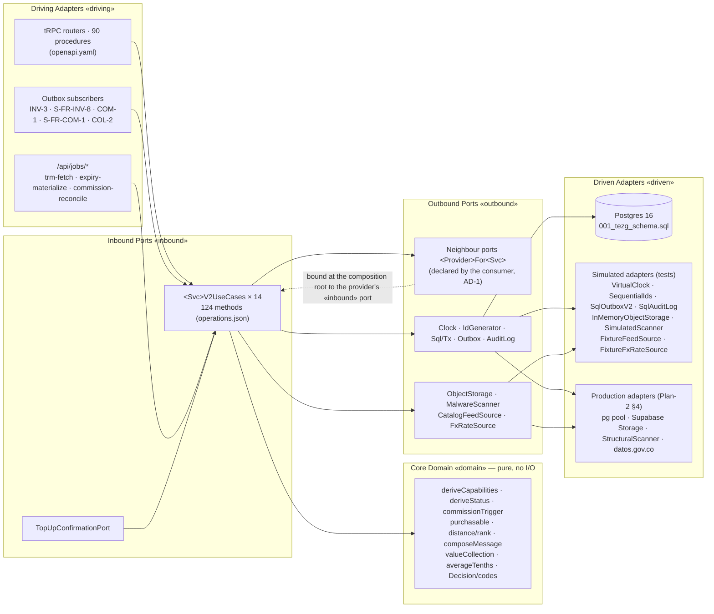

# Ports & Adapters map

Every component of the detailed design appears **exactly once** below, in exactly one layer. The registry `schemas/operations.json` is the source for:
- the inbound ports (`<Svc>V2UseCases`);
- the outbound neighbour ports (`<Provider>For<Svc>`);
- each module's dependency set (`<Svc>V2Deps`).

`node scripts/gen-solu2-api.mjs --check` fails when those files drift from the registry.

## 0. Hard rules and how each is enforced

| # | Rule (statement §5) | Enforced by |
|---|---|---|
| 1 | `domain/` imports no web framework, DB driver, wall clock, random or network | `scripts/check-domain-purity.mjs` (`npm run gate:purity`): allowed imports are `shared-kernel/{types,errors,decision,codes}` and sibling domain files; `Date.now()`, a bare `new Date()`, `performance.now()`, `Math.random()`, crypto randomness, `fetch()` and SQL `now()` fail. It was verified to fail on a probe file |
| 2 | Time and ids enter only through `Clock` and `IdGenerator` | Every `<Svc>V2Deps` carries `clock` and `ids`, and no raw `Sql` (R-14); each contract states "`Clock`, once" (contracts §0.3); the SQL has no `DEFAULT now()` and no id default (`001_tezg_schema.sql` header) |
| 3 | Every external interaction is behind an outbound port with a simulated adapter | `src/shared-kernel/external.ts` declares the ports, `test-support/simulated/index.ts` implements them (§1), and the NFR-SYS-3 network guard (Phase 3 `db` fixture) fails any non-Postgres socket |
| 4 | DTOs are primitive-typed | `*.v2.dto.ts` use only `string`, `number`, `boolean`, `null`, literal unions, arrays and inline objects over the `shared-kernel/types.ts` aliases. The generator's type parser rejects anything else (a class, `Date`, a generic other than `Record`), so `openapi.yaml` cannot be built from a non-primitive DTO |

## 1. Shared kernel (`src/shared-kernel/`)

| Component | Layer | Production binding (Plan-2) | Simulated binding (tests) |
|---|---|---|---|
| `Clock` (`ports.ts`) | **Outbound Port** (time) | `shared-kernel/clock/system.ts`, the only file allowed to read the system clock | `VirtualClock` (`test-support/clock.ts`), seeded at `2026-10-01T15:00:00Z` |
| `IdGenerator` (`ports.ts`) | **Outbound Port** (ids) | cuid2 | `SequentialIds` plus `id(name)` (`test-support/ids.ts`) |
| `Sql`, `Tx`, `TransactionRunner` (`ports.ts`) | **Outbound Port** (persistence transport) | pg `Pool` (max 1) behind the Supabase pooler, with `db()` ambient-transaction resolution (AD-SYS-4 rule 9) | per-file Docker Postgres database (`test-support/db.ts`) |
| `OutboxV2` + `EventEnvelope` (`events.ts`) | **Outbound Port** (events) | `outbox.enqueue(tx, type, aggregateId, payload)` into `OutboxEvent`/`EventDelivery`, returning the R-1 envelope (R-14, review S-1) | `SqlOutboxV2 implements OutboxV2`, plus the `SubscriberFaults` fault injector |
| `AuditLog` (`audit.ts`) | **Outbound Port** (audit, R-2) | an insert into `audit_events` in the writer's transaction | `SqlAuditLog` (the same SQL on the test database) |
| `ObjectStorage` (`external.ts`) | **Outbound Port** (external: Supabase Storage) | Supabase signed upload URLs; private buckets | `InMemoryObjectStorage`: refuses to sign `upload-quarantine` and records every signed read |
| `MalwareScanner` (`external.ts`) | **Outbound Port** (external) | `StructuralScanner` [G-4] | `SimulatedScanner`: magic bytes, PDF names, image re-encode by end marker, and a missing end marker rejected (review S-3); `failAll` switch |
| `CatalogFeedSource` (`external.ts`) | **Outbound Port** (external: the feed, OQ-9) | the fixture feed until OQ-9 names a source | `FixtureFeedSource` over the ADD-§8 files `{ current, previous, defects, renamed }`, with the ADD-§8.3 switches `down`, `stale`, `malformedRows`, `renamedRows` (review S-2) |
| `FxRateSource` (`external.ts`) | **Outbound Port** (external: datos.gov.co TRM) | HTTP adapter in `catalog/infra/` (the only `fetch`, lint `tezg/no-direct-io`) | `FixtureFxRateSource` with switches `down`, `mismatch` |
| `TopUpConfirmationPort` (`external.ts`) | **Inbound Port** (a v2 webhook or the V1 admin action drives it) | the V1 admin action | `AdminTopUpConfirmation` (forwards to COM-2 and its reject mirror) |
| `Decision`, `ExplanationDTO`, `ErrorBody` (`decision.ts`, `explanation.ts`) | **Core Domain** (shared value types) | — | — |
| `DOMAIN_ERRORS`, `DECISION_CODES` (`codes.ts`), `DomainError`, `NotImplementedError` (`errors.ts`) | **Core Domain** (registry, AD-SYS-1) | — | — |
| `AdminEventsServiceV2` (`admin-events.ts`: `replayEventDelivery`, `getDeliveryHealth`) | **Inbound Port** | shared-kernel outbox owner | generated stub |
| Dispatcher and sweeper (AD-SYS-2 rules 4–6) | **Driving Adapter** (runs subscribers after commit, and from the jobs) | in-process | test dispatcher with `SubscriberFaults` (Phase 3 `sim_events`) |

## 2. Per host module

In every row, *file* is relative to `src/modules/<host>/`. Each **Driving Adapter** row names the tRPC procedures, subscribers or jobs, listed with their wire inputs in `openapi.yaml`. Each one calls exactly one inbound-port method, and the actor fields come from the session (`x-actor-fields-from-session`). Every module's application service reaches its own tables only through its **repository port** `<Svc>Repository` (`ports/<file>.v2.ts`, an Outbound Port; R-14, review A-4). The port is empty until each story adds the methods its contract's SQL needs. Its **Driven Adapter (Database)** is `infra/pg.ts`, which touches only that module's section of `001_tezg_schema.sql` (AD-8). No `application/*.v2.ts` imports `Sql`.

### 2.1 `identity` — IDN, VER (MSG-3 is offered here)

| Component | Layer | File / binding | Rule |
|---|---|---|---|
| Router `access` (`completeIndividualProfile`, `traceCapabilities`); router `verification` (9 procedures); Better Auth hooks (sign-in/sign-up throttle) | **Driving Adapter** | `server/trpc/` | AD-SYS-8 rules 1–2 |
| `IdnV2UseCases` (12 methods), `VerV2UseCases` (11 methods) | **Inbound Port** | `application/idn.v2.ts`, `application/ver.v2.ts` | contracts §1, §2, §15 |
| `deriveCapabilities`, `evaluateSubmission` (existing); NIT mod-11 check (new, VER-2 story) | **Core Domain** | `domain/idn.ts`, `domain/ver.ts` | AD-IDN-1 rule 2, AD-VER-1 |
| `IdnV2Deps`, `VerV2Deps` (no neighbour: `identity` depends on no module, AD-1); `VerV2Deps.storage`, `.scanner` | **Outbound Port** | `ports/idn.v2.ts`, `ports/ver.v2.ts` | AD-1, AD-SYS-8 rule 5 |
| `legalIdentityRepository` (the only reader of `BusinessApplicationLegalIdentity`); `PgUserRepository` | **Driven Adapter** (Database) | `infra/` | AD-VER-2 rule 1 (lint `tezg/legal-identity-confined`) |

### 2.2 `catalog` — CAT (no module dependencies)

| Component | Layer | File / binding | Rule |
|---|---|---|---|
| Router `catalog` (`feed.start`, `feed.continue`, `provenance`, `browse`, `fx.retry`); job `trm-fetch` | **Driving Adapter** | `server/trpc/`, `app/api/jobs/` | admin guard in `server/trpc/admin-guard.ts` (Solu-1 E-23) |
| `CatV2UseCases` (14 methods, including the offered ports P-CAT.*) | **Inbound Port** | `application/cat.v2.ts` | contracts §3, §15.11 |
| `validateRow`, `diffAttributes` (existing); `copFromUsd` (shared-kernel money helper, new) | **Core Domain** | `domain/cat.ts` | AD-CAT-1, AD-CAT-2, AD-SYS-7 |
| `CatV2Deps` (`feed`, `fx`; no neighbour) | **Outbound Port** | `ports/cat.v2.ts` | AD-1 (`catalog` has no edge) |
| `PgCatalogRepository`; the TRM HTTP adapter | **Driven Adapter** (Database / external) | `infra/` | AD-CAT-3 rule 6 |

### 2.3 `listings` — INV, DSC, MSG contact (MSG-2), REP listing moderation

| Component | Layer | File / binding | Rule |
|---|---|---|---|
| Routers `inventory` (12 procedures) and `discovery` (2); subscribers `onCommissionBalance*` (INV-3) and `onBusinessApplication*` (S-FR-INV-8) | **Driving Adapter** | `server/trpc/`, outbox subscribers | AD-INV-3 |
| `InvV2UseCases` (19), `DscV2UseCases` (3), `ContactV2UseCases` (1) | **Inbound Port** | `application/inv.v2.ts`, `dsc.v2.ts`, `contact.v2.ts` | contracts §4, §5, §9, §15 |
| `purchasable`, `availability`, `validateSearchArea`, `haversineKm`, `insideRadius`, `compareRank` (existing); `composeMessage`, `encodeWaMe`, `truncate` (new, MSG-2 story) | **Core Domain** | `domain/inv.ts`, `domain/dsc.ts` | AD-INV-3 rule 2, AD-DSC-1, AD-MSG-1 rule 4 |
| `IdentityForInv`, `CatalogForInv`; `IdentityForDsc`, `CatalogForDsc`; `IdentityForContact`, `CatalogForContact` | **Outbound Port** (neighbours) | `ports/*.v2.ts` | AD-1 (`listings → identity, catalog`) |
| `PgListingRepository`, `ContactRequestLog` limiter | **Driven Adapter** (Database) | `infra/` | AD-INV-2, AD-MSG-1 rule 3 |

### 2.4 `orders` — ORD

| Component | Layer | File / binding | Rule |
|---|---|---|---|
| Router `orders` (13 procedures); job `expiry-materialize` | **Driving Adapter** | `server/trpc/`, `app/api/jobs/` | AD-ORD-1, AD-ORD-2 rule 7 |
| `OrdV2UseCases` (14) | **Inbound Port** | `application/ord.v2.ts` | contracts §6 |
| `deriveStatus`, `paidLoserCode` (existing); the visibility predicate builder (new, S-FR-ORD-6 story) | **Core Domain** | `domain/ord.ts` | AD-ORD-2 rule 8, AD-ORD-3 rule 1 |
| `ListingsForOrd` (INV-1, S-FR-INV-5, P-INV.purchase, P-INV.units), `IdentityForOrd` (S-FR-VER-9.get); `storage`, `scanner` | **Outbound Port** | `ports/ord.v2.ts` | AD-1 (`orders → listings, identity`) |
| `PgOrderRepository` | **Driven Adapter** (Database) | `infra/pg.ts` | AD-ORD-2 CHECKs |

### 2.5 `commission` — COM

| Component | Layer | File / binding | Rule |
|---|---|---|---|
| Router `commission` (7 procedures); subscribers `onOrderPaymentConfirmedByBusiness`, `onOrderClosed` (COM-1), `onBusinessApplicationApproved` (S-FR-COM-1); job `commission-reconcile` | **Driving Adapter** | `server/trpc/`, subscribers, jobs | AD-SYS-3 |
| `ComV2UseCases` (9) | **Inbound Port** | `application/com.v2.ts` | contracts §7 |
| `commissionTrigger`, `commissionOf`, `crossing` (existing) | **Core Domain** | `domain/com.ts` | AD-SYS-3 rule 2, ADD-§2.6, AD-COM-1 rule 3 |
| `IdentityForCom` (P-IDN.capabilities, P-VER.name); `storage`, `scanner` | **Outbound Port** | `ports/com.v2.ts` | AD-1 (`commission → identity`) |
| `PgLedgerRepository` (`LedgerService.apply`) | **Driven Adapter** (Database) | `infra/pg.ts` | AD-COM-1 rules 1–2 |

### 2.6 `trading` — TRD

| Component | Layer | File / binding | Rule |
|---|---|---|---|
| Router `trading` (8 procedures); job `expiry-materialize` (offers) | **Driving Adapter** | `server/trpc/` | AD-TRD-1 |
| `TrdV2UseCases` (9) | **Inbound Port** | `application/trd.v2.ts` | contracts §8 |
| `deriveOfferStatus`, `turnVerdict` (existing); `canonicalTerms` for G-1 (new, TRD-2 story) | **Core Domain** | `domain/trd.ts` | AD-TRD-1 rules 3, 5 |
| `ListingsForTrd` (P-INV.trade, P-INV.tradeability, S-FR-INV-5, P-INV.refs, MSG-2) | **Outbound Port** | `ports/trd.v2.ts` | AD-1 (`trading → listings` only; OQ-6) |
| `PgTradeRepository` | **Driven Adapter** (Database) | `infra/pg.ts` | AD-TRD-2 lock order |

### 2.7 `messaging` — MSG in-app

| Component | Layer | File / binding | Rule |
|---|---|---|---|
| Router `messaging` (5 procedures) | **Driving Adapter** | `server/trpc/` | AD-MSG-2 |
| `MsgV2UseCases` (5) | **Inbound Port** | `application/msg.v2.ts` | contracts §9, §15 |
| `sendEligibility`, `normalizeBody` (existing); unread and read-seq clamp (new, S-FR-MSG-7 story) | **Core Domain** | `domain/msg.ts` | AD-MSG-3 rules 1–2 |
| `IdentityForMsg` (MSG-3, P-IDN.names, P-VER.name) | **Outbound Port** | `ports/msg.v2.ts` | AD-1 (`messaging → identity`) |
| `PgConversationRepository` | **Driven Adapter** (Database) | `infra/pg.ts` | AD-MSG-2 unique keys |

### 2.8 `collections` — COL, VAL

| Component | Layer | File / binding | Rule |
|---|---|---|---|
| Routers `collections` (15 procedures) and `valuation` (3); subscriber `onOrderClosed` (COL-2) | **Driving Adapter** | `server/trpc/`, subscriber | AD-COL-2 |
| `ColV2UseCases` (15), `ValV2UseCases` (3) | **Inbound Port** | `application/col.v2.ts`, `val.v2.ts` | contracts §10, §11, §15 |
| `completionPercent`, `bogotaDate`, `isValuationPeriod`, `valueEntries`, `changePercentHundredths` (existing); `binderSort`, `validateExternal`, `series` (new, in their stories) | **Core Domain** | `domain/col.ts`, `domain/val.ts` | AD-COL-1, AD-VAL-1, AD-VAL-2 |
| `CatalogForCol`, `ListingsForCol`; `CatalogForVal` | **Outbound Port** | `ports/col.v2.ts`, `ports/val.v2.ts` | AD-1 (`collections → catalog, listings`) |
| `PgCollectionRepository` | **Driven Adapter** (Database) | `infra/pg.ts` | AD-COL-1 CHECKs |

### 2.9 `reviews` — REP

| Component | Layer | File / binding | Rule |
|---|---|---|---|
| Router `reputation` (6 procedures); the 2.2 / 3.1 RSC composition calling `getAggregates` | **Driving Adapter** | `server/trpc/`, `app/` | §2 of Plan-2: UI-only composition |
| `RepV2UseCases` (7) | **Inbound Port** | `application/rep.v2.ts` | contracts §12 |
| `averageTenths`, `reviewVerdict` (existing) | **Core Domain** | `domain/rep.ts` | AD-REP-2 rule 1 |
| `IdentityForRep` (S-FR-IDN-6.target, P-IDN.names), `OrdersForRep` (S-FR-ORD-9) | **Outbound Port** | `ports/rep.v2.ts` | AD-1 (`reviews → orders, identity`) |
| `PgReviewRepository` (no `DELETE`) | **Driven Adapter** (Database) | `infra/pg.ts` | AD-12, AD-REP-2 rule 3 |

## 3. Diagram (layer-tagged)

## 4. Dependency edges the ports realize (AD-1, unchanged)

`listings → identity, catalog` · `orders → listings, identity` · `commission → identity` · `trading → listings` · `messaging → identity` · `collections → catalog, listings` · `reviews → orders, identity`. `catalog` and `identity` depend on no module. The dashed edges of AD-1 are events only (`events.md`). The generator derives each `<Provider>For<Svc>` from the registry's `consumers`, and every resulting edge is in this list. A consumer that named an edge outside it would show up as a new neighbour interface in review, and as an import of `../../<host>/index.js` in the generated port file.
